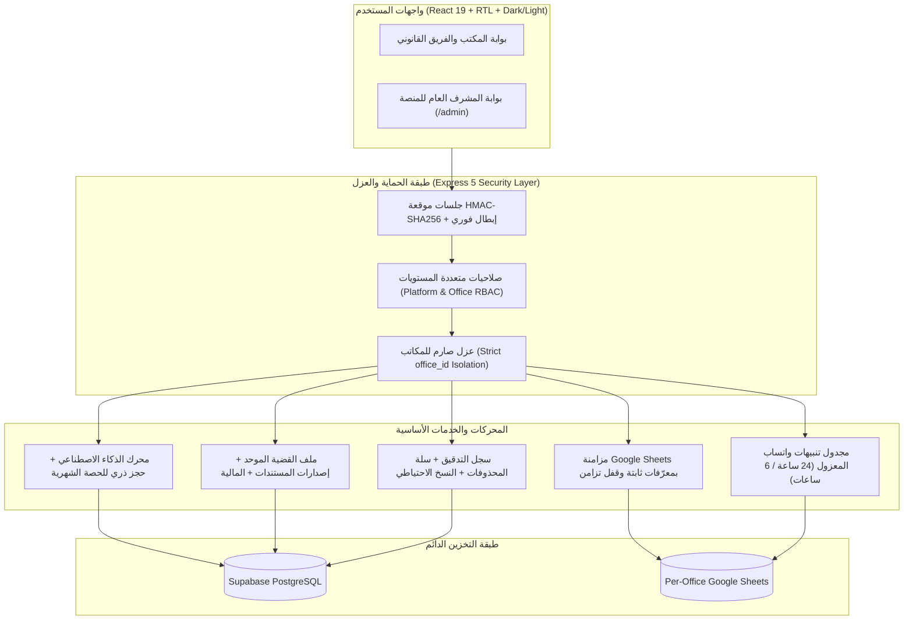

<div align="center">

# ⚖️ المنظومة السحابية المتكاملة لإدارة مكاتب المحاماة والجلسات القضائية
### Enterprise Multi-Tenant Legal Practice & Court Session Management SaaS

<p align="center">
  <a href="https://github.com/Eng-yousef-khalaf/Low">
    
  </a>
  <a href="https://github.com/Eng-yousef-khalaf/Low/actions/workflows/ci.yml">
    
  </a>
  
  
  
  
  
</p>

<p align="center">
  <b>تصميم وهندسة وتطوير: المهندس يوسف خلف (Eng. Yousef A. Khalaf)</b><br/>
  <a href="https://github.com/Eng-yousef-khalaf">
    
  </a>
  <a href="https://yousef-khalaf.vercel.app/">
    
  </a>
</p>

</div>

---

## 📖 نبذة تنفيذية (Overview)

**منظومة سحابية متكاملة متعددة المكاتب (`Multi-Tenant Legal SaaS`)** مصممة خصيصاً لمكاتب المحاماة والشركات القانونية والمحامين الممارسين في الأنظمة القضائية العربية.

تجمع المنظومة بين **التحليل الذكي لرسائل وإشعارات المحاكم بالذكاء الاصطناعي**، و**ملف القضية المركزي الموحد**، و**إدارة الموكلين والأتعاب المالية**، و**جدولة الجلسات مع كشف التعارضات الزمنية**، و**التنبيهات الاستباقية عبر واتساب**، ضمن بنية أمنية صارمة تعزل بيانات كل مكتب محاماة بشكل كامل وتدعم التدقيق والنسخ الاحتياطي واسترجاع المحذوفات.

---

## 🏛️ المعمارية الهندسية للنظام (System Architecture)



---

## ✨ الوحدات والمميزات الرئيسية (Core Modules & Features)

### 1. 🧠 التحليل الذكي لرسائل المحاكم وإدارة الجلسات (`/chat` & `/sessions`)
* **استخراج فوري بالذكاء الاصطناعي** لرقم القضية، المحكمة، الدائرة، أطراف الدعوى، نوع الجلسة، والتاريخ الهجري/الميلادي والوقت من رسائل المحكمة النصية (`SMS`) مع محرك احتياطي ذكي (`Fallback Extractor`).
* **إضافة يدوية مستقلة للجلسات** تعمل بكفاءة كاملة حتى بدون استخدام الذكاء الاصطناعي.
* **تقويم الفريق وكشف تعارض المواعيد (`Conflict Detection`):** عرض جدولي وتقويمي حسب المحامي المكلف مع تنبيه فوري عند تداخل مواعيد جلستين لنفس المحامي.
* **التقارير الرسمية للجلسات (`/reports`):** إعداد وتصدير تقارير الجلسات الاحترافية بصيغة `PDF` جاهزة للطباعة ومشاركتها مع الموكلين.

### 2. 🗂️ ملف القضية الموحد وإصدارات المستندات (`/cases`)
* ملف مركزي يربط **الموكل، الجلسات، المهام، الأحكام، المستندات، وكشف الحساب المالي** بمعرّف قضية ثابت.
* **أرشفة المستندات وتعدد الإصدارات (`Document Versioning`):** حفظ المذكرات وصكوك الأحكام والعقود مع تتبع رقم الإصدار وتاريخ الرفع والمستخدم الرافع.

### 3. 👥 إدارة الموكلين والشؤون المالية والأتعاب (`/clients`)
* ملفات مستقلة للأفراد والشركات تشمل بيانات الهوية/السجل التجاري والتواصل وجميع القضايا المرتبطة.
* **دفتر الأستاذ المالي للقضايا:** تسجيل العقود، الدفعات المحصلة، المصروفات القضائية، والفواتير مع احتساب فوري للمتبقي وصلاحيات وصول مخصصة للمحاسب ومدير المكتب.

### 4. 📜 الوكالات الشرعية، الأحكام القضائية، والمهام (`/poa`, `/judgments`, `/tasks`)
* **سجل الوكالات الشرعية (`/poa`):** متابعة سريان الوكالات وتنبيهات قرب انتهائها مع طابور مزامنة محلي معزول لكل حساب (`Scoped Pending Sync Queue`) يحفظ المدخلات بأمان عند انقطاع الاتصال دون ضياعها.
* **سجل الأحكام القضائية (`/judgments`):** توثيق صكوك الأحكام الابتدائية والنهائية وتصنيفها (لصالح المكتب / ضد) مع ربطها بالمحامي المكلف والقضية.
* **إدارة المهام القانونية (`/tasks`):** إسناد المهام لأعضاء فريق المكتب الفعليين مع تتبع تواريخ الاستحقاق الهجرية والميلادية والأولويات.

### 5. 🏢 إدارة المكتب وتعدد الأدوار والصلاحيات (`/team`)
* فصل كامل بين **مشرف المنصة العام (`Platform Admin`)** و**مدير المكتب (`Office Manager`)** وأعضاء المكتب:
  * **مدير المكتب:** إشراف كامل، إدارة الفريق، المالية، الإعدادات، وسجل التدقيق والنسخ الاحتياطي.
  * **محامٍ ممارس:** متابعة القضايا والجلسات والمذكرات المسندة.
  * **مساعد قانوني:** جدولة المواعيد وإدخال البيانات ومتابعة المهام.
  * **محاسب مالي:** إدارة الأتعاب والدفعات والمصروفات والتقارير المالية فقط.

### 6. 🛡️ بوابة المشرف العام وإدارة الاشتراكات (`/admin`)
* إدارة حسابات المكاتب وباقات الاشتراك (`Plus` و `Pro`) بنظام إضافة متدرج من 3 خطوات وملخص مراجعة قبل الحفظ ولوحة تحكم جانبية مستقلة.
* **حصة ذكاء اصطناعي شهرية معزولة لكل مشترك** مع حجز ذري للرصيد (`Atomic Quota Reservation`) وتجديد شهري تلقائي بتوقيت الرياض.
* تخصيص ملفات اعتماد `Google Service Account` ومعرّف جدول مستقل لكل مكتب محاماة.

### 7. 🕵️ التدقيق، سلة المحذوفات، والنسخ الاحتياطي (`/api/audit`)
* **سجل تدقيق شامل (`Audit Trail`):** توثيق كافة عمليات الإضافة والتعديل والحذف وتغييرات الصلاحيات.
* **الحذف الآمن القابل للاسترجاع (`Soft Delete & Restore`):** إمكانية استعادة الجلسات أو الوكالات أو المهام أو الأحكام أو القضايا أو العملاء المحذوفين بالخطأ.
* **النسخ الاحتياطي الموثق (`JSON Snapshot & Verification`):** تصدير نسخة احتياطية كاملة لبيانات المكتب وفحص سلامتها ومطابقتها للمخطط المعتمد.

---

## 🔒 ركائز الأمان والاعتمادية الهندسية (Security & Engineering Standards)

| المجال الأمني والهندسي | الآلية المطبقة في المنظومة |
| :--- | :--- |
| **توثيق الجلسات (`Session Auth`)** | رموز جلسات موقعة خوارزمياً بـ `HMAC-SHA256` داخل كوكيز `HttpOnly` مع مقارنة ثابتة الزمن `timingSafeEqual` ورفض تام لأي كوكي غير موقعة. |
| **الإبطال الفوري للصلاحيات** | بصمة جلسة ديناميكية (`Session Fingerprint`) تبطل الجلسات النشطة فوراً عند تغيير الدور أو إيقاف الحساب أو تحديث كلمة المرور أو الحذف. |
| **العزل الصارم للمكاتب (`Multi-Tenancy`)** | كل عملية قراءة أو كتابة أو تنبيه مقيدة بـ `office_id` الخاص بالمستخدم الموثق، مع منع التحول التلقائي لأي جدول عام غير مصرح به. |
| **سلامة البيانات والتزامن** | معرّفات سجلات ثابتة مستقلة عن رقم الصف في الشيت (`RowMeta`) مع قفل تزامن متسلسل (`withSheetLock`) ومنع تكرار الطلبات (`Idempotency`). |
| **التحقق من المدخلات والتواريخ** | مخططات `Zod` صارمة بالخادم، دعم كامل للأرقام العربية الشرقية (`٠-٩`)، والتحقق الدقيق من نطاقات التقويمين الهجري والميلادي. |
| **حماية مسارات الجدولة (`Cron`)** | جدولة متكررة تتوافق مع نافذتي 24 ساعة و6 ساعات، محمية بمفتاح `CRON_SECRET` إلزامي في بيئة الإنتاج مع عدم تسريب تفاصيل القضايا في السجلات التقنية. |

---

## 📂 هيكلية المستودع (Repository Structure)

```text
Low/
├── api/                                     # حزم Vercel Serverless الجاهزة للنشر السحابي
├── artifacts/
│   ├── api-server/                          # الخادم الخلفي (Node.js, Express 5, TypeScript)
│   │   ├── src/__tests__/                   # اختبارات التكامل والأمان وعزل المكاتب
│   │   ├── src/config/                      # إدارة البيئة ومخزن الإعدادات الدائم
│   │   ├── src/lib/                         # معالج الأخطاء الموحد بأرقام مرجعية والسجلات
│   │   ├── src/middlewares/                 # التوثيق، فحص الاشتراكات، ومحدد المعدل المركزي
│   │   ├── src/routes/                      # مسارات الـ API (Auth, Cases, Clients, Sessions, POA, Tasks, Judgments, Team, Audit, Cron)
│   │   ├── src/scheduler/                   # مجدول التنبيهات المعزول لكل مكتب
│   │   ├── src/services/                    # خدمات الأعمال والتكامل (Supabase, Google Sheets, AI, WhatsApp)
│   │   └── src/utils/                       # تطبيع التواريخ الهجرية/الميلادية وأقفال التزامن
│   └── court-session-management/            # تطبيق الواجهة الأمامية (React 19, Vite 6, Tailwind CSS)
│       ├── src/components/                  # المكونات المشتركة (DateField, TeamSelect, ThemeProvider, Sidebar)
│       ├── src/lib/                         # أدوات التحقق والتخزين المحلي المعزول لكل حساب
│       └── src/pages/                       # واجهات النظام وبوابة الإدارة
├── lib/
│   ├── api-client-react/                    # عميل الـ API وخطافات React Query
│   ├── api-spec/                            # مواصفات OpenAPI
│   └── api-zod/                             # مكتبة التحقق المشتركة (Zod)
├── vercel.json                              # إعدادات التوجيه وجدولة التنبيهات على Vercel
└── package.json                             # أوامر البناء والفحص والاختبار الموحدة
```

---

## ⚙️ متغيرات البيئة الأساسية (Environment Configuration)

أنشئ ملف `.env` في جذر المشروع (أو أضف المتغيرات في إعدادات Vercel للإنتاج):

| المتغير | الوصف | إلزامي في الإنتاج؟ |
| :--- | :--- | :---: |
| `SESSION_SECRET` | مفتاح سري عشوائي قوي (32 حرفاً فأكثر) لتوقيع جلسات الدخول `HMAC-SHA256` | نعم |
| `SUPABASE_URL` | رابط مشروع قاعدة البيانات في Supabase | نعم |
| `SUPABASE_SERVICE_ROLE_KEY` | مفتاح الخدمة السري في Supabase لإدارة الحسابات والإعدادات الدائمة | نعم |
| `CRON_SECRET` | رمز سري لتوثيق استدعاءات مجدول التنبيهات `/api/cron/reminders` | نعم |
| `AI_INTEGRATIONS_OPENAI_API_KEY` | مفتاح مزود الذكاء الاصطناعي (`Groq` / `Gemini` / `OpenAI`) | اختياري (أو من لوحة الإدارة) |

---

## 🚀 التشغيل السريع والاختبار والبناء (Quick Start & CI Commands)

### 1. المتطلبات
* **Node.js** `v20+` (مختبر بالكامل على `Node.js v22+`).
* مدير الحزم **pnpm**.

### 2. تثبيت الحزم
```bash
pnpm install
```

### 3. فحص الأنواع وتشغيل الاختبارات الأمنية
```bash
# فحص TypeScript الشامل للواجهة والخادم والحزم المشتركة
pnpm run typecheck

# تشغيل حزمة اختبارات الأمان وعزل المكاتب والاسترجاع
pnpm run test
```

### 4. البناء الكامل للإنتاج (يشغّل الاختبارات تلقائياً قبل اعتماد البناء)
```bash
pnpm run build
```

### 5. التشغيل المحلي للتطوير
```bash
pnpm run dev
```

---

## 👨‍💻 المؤلف وحقوق التطوير (Author)

تم تصميم وهندسة وتطوير هذه المنظومة بالكامل بواسطة:

**المهندس يوسف خلف — Eng. Yousef A. Khalaf**
* 🔗 **GitHub:** [@Eng-yousef-khalaf](https://github.com/Eng-yousef-khalaf)
* 🌐 **الموقع الشخصي (Portfolio):** [yousef-khalaf.vercel.app](https://yousef-khalaf.vercel.app/)

---

<div align="center">
  <sub>© 2026 Eng. Yousef A. Khalaf — All Rights Reserved. Built for Modern Legal Practice Excellence.</sub>
</div>
